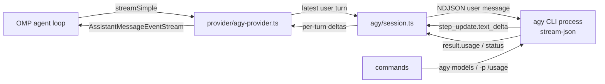

# Architecture

## Layers

| Layer | Files | Responsibility |
|---|---|---|
| Entry | `src/index.ts` | Read config, build the manager, register provider and commands, clean up on exit |
| Provider | `src/provider/agy-provider.ts` | Model metadata for `registerProvider`, `AssistantMessage` construction, OMP stream events |
| Transport | `src/agy/session.ts` | Spawn one `agy` process per (cwd, model), queue turns, parse events, abort/timeout |
| Framing | `src/agy/protocol.ts` | NDJSON line buffer and event type |
| Context | `src/agy/prompt.ts` | Latest user turn, one-time system prefix |
| Accounting | `src/agy/usage.ts` | Cumulative → delta, thinking folded into output |
| Introspection | `src/agy/models.ts` | `agy models`, `agy -p /usage`, `agy --version` |
| Commands | `src/commands/index.ts` | `/agy-*` |

## Turn lifecycle

1. OMP calls `streamSimple(model, context, options)`.
2. The provider extracts the latest user text and the system prompt.
3. `AgySession.send` serializes the turn, writing
   `{"event":"user","message":{"content": ...}}` to the child's stdin.
4. `step_update.text_delta` events become OMP `text_delta`; one `result` event
   closes the turn.
5. Cumulative usage is diffed against the previous sample; the delta becomes the
   OMP `Usage` of the turn.
6. Non-`SUCCESS` status, child exit, abort, or watchdog expiry surface as stream
   errors with agy's status and bounded stderr.

## Process model

- One child per `(cwd, model)`; a new model is a new conversation.
- Turns are serialized per session with a promise chain.
- `SIGTERM` on abort/exit, `SIGKILL` after two seconds.
- `process.once("exit" | "SIGTERM")` closes every session.

## Failure modes and responses

| Symptom | Response |
|---|---|
| `result.status=ERROR` | Reject with agy's `error` text; status preserved on `AgyError` |
| `WAITING` (tool needs approval) | Same error path; message points at the CLI's permission notice |
| Child exit mid-turn | Reject with `EXIT <code>` and stderr tail |
| Abort signal | Kill child, reject `ABORTED`; OMP maps to an aborted stream |
| Watchdog expiry | Kill child, reject `TIMEOUT` |
| Split JSON line | `NdjsonLineBuffer` holds the remainder until the newline |
